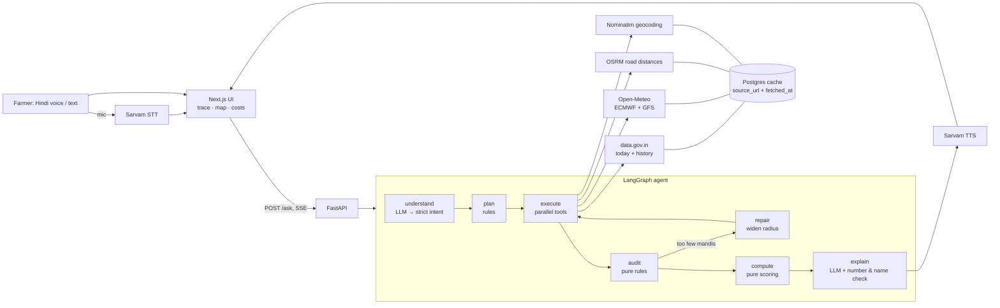

# Harvest Compass — हार्वेस्ट कम्पास

**Which mandi to sell in, and which days are safe to harvest and transport.** A farmer near Indore asks in Hindi, by voice or text. An agent pulls live mandi prices, two weather models and real road distances, checks the data, and replies in plain spoken Hindi. It shows every step, every source, and every number's origin.

Built for FORGE '26. Region: Madhya Pradesh (Indore radius 150 km, widened to 250 km when data is thin). Crops: soybean and onion, chosen by data coverage in M0.

## The problem
A farmer with 40 quintals of soybean usually sells at the nearest mandi, or wherever a trader says. Prices differ between mandis, and so does the transport cost to reach them. Some published prices are stale, or are outliers from one odd lot. Rain on harvest or transport day ruins crop. The information is public but scattered, in English, and unchecked.

## What it does
- **The farmer's own language, English by default.** Pick from English and the 22 scheduled Indian languages. The agent understands the question and answers in that language. Voice input works in all of them; spoken replies work in the 9 that Sarvam's bulbul:v4-flash has voices for (English, Hindi, Bengali, Marathi, Telugu, Tamil, Gujarati, Kannada, Punjabi); the rest get text. Page labels exist in English and Hindi.
- **Asks instead of guessing.** Ambiguous village ("which Rampur?"), sacks without a weight, missing vehicle hire, an unlikely quantity: one short question each, never a made-up value.
- **Net ₹ per quintal, not headline price.** Each mandi's 7-day median modal price (3+ reports, else its latest) minus round-trip transport at the farmer's own rate, across all reachable mandis. If a farther mandi wins by ₹50/quintal or less, the nearer one is recommended and the skipped one is named. Drive-time caps are tighter for onion.
- **Audits the data visibly.** Rejects stale (>3 days), inconsistent (min > max) and outlier prices (robust z-score against the mandi's own 30 days and the region), and keeps like-for-like variety and grade. Each rejected mandi is named with its reason.
- **Repairs itself.** Today's price feed down → each mandi's latest report, with its age. One weather model down → the other, with days marked uncertain. Too few usable mandis → widen the radius. All shown live in the trace.
- **Safe days.** ECMWF and GFS daily rain from Open-Meteo. A day is "safe" only when both models agree it's dry, and the transport day after it counts too.
- **"What if I wait N days?"** The 14-day price trend at the best mandi plus rain risk, labelled *trend, not forecast*.
- **Grounded answers.** The LLM only phrases facts we computed. A validator rejects any number not in the facts, and any change to the mandi's name. It retries once, then falls back to a fixed template.

## Architecture



- **Backend:** FastAPI, LangGraph, httpx, Pydantic v2, psycopg 3 (Neon Postgres). `backend/app/`: `tools/` (one file per source), `scoring/` (pure functions), `agent/` (graph and nodes), `backtest/`.
- **Frontend:** Next.js 15, TypeScript, Tailwind, Leaflet. Pages: `/` home, `/ask` the agent (Hindi-first), `/how-it-works`, `/results` (live backtest, grounding, usage stats), `/data` (sources and licences), `/about`. Light glass design: Baloo 2 + Mukta, a sky-to-field gradient.
- **LLM:** `deepseek/deepseek-v4.1-flash` via OpenRouter, used only for extracting intent and phrasing Hindi. It never computes a number. Chosen by test: see Results.

## Results (measured, 31 Oct 2026)
**Backtest** (`backend/app/backtest/run_backtest.py`). 30 real OSM villages, 60 days (31 Aug–30 Oct 2026), real data.gov.in history:
- Each day, decide with only that day's data, using the agent's own audit and ranking.
- Realise the price at the chosen mandi the next day.
- Compare with the nearest mandi.

Transport is a swept assumption (₹0.5/1/2 per quintal-km), not a measured rate. Mean gain vs nearest mandi, ₹/quintal:

| | Rank on today's price | 7-day median | 7-day median + nearer on close calls (**live**) |
|---|---|---|---|
| Onion | +437 / +401 / +379 | +540 / +482 / +429 | +511 / +470 / +413 |
| Soybean | +27 / −32 / −73 | +61 / +15 / −4 | +69 / +39 / −5 |

Choosing the mandi pays for onion, where prices differ a lot between mandis. For soybean, prices are nearly uniform across MP, so the nearest mandi is about as good. Ranking on a 7-day median beats one day's price everywhere, because single-day spikes often don't last until the farmer arrives. Preferring the nearer mandi on close calls (≤ ₹50/q) helps soybean and costs onion ₹12–29/q on average, for shorter trips. About 30% of decisions couldn't be scored, because the chosen mandi didn't report the next day.

**Grounding test** (`backend/scripts/grounding.py`), 20 varied Hindi/Hinglish questions:

| Model | Answered (of 20) | Invented numbers | Median / p95 time |
|---|---|---|---|
| deepseek-v4.1-flash | 19 | 0 | 11.4 s / 15.3 s |

The 20th question correctly asks to confirm the tahsil (Mahidpur exists in OSM only as a tahsil). In a comparison, GPT-5.6 Terra also invented 0 numbers but transliterated a mandi name into the wrong town (Badnagar → "बदनावर"). Hence the name check, and deepseek as the demo model. Claude Sonnet 5.5 couldn't run: it doesn't support the forced tool call we use.

**Voice test:** 10 real recordings, results to be added.

## Data sources and licences
| Source | Used for | Licence / terms |
|---|---|---|
| [data.gov.in](https://data.gov.in) — Daily mandi prices (resource `9ef84268-…`) and variety-wise history (`35985678-…`) | prices | Government Open Data License – India |
| [Open-Meteo](https://open-meteo.com) — ECMWF IFS 0.25° and GFS | rain forecast | CC BY 4.0, attribution shown in the UI |
| [OSRM](https://project-osrm.org) public router | road km and drive time | OSM data, ODbL |
| [Nominatim](https://nominatim.org) | village and mandi coordinates | OSM data, ODbL. Max 1 request/s, identifying User-Agent, results cached |
| [OpenStreetMap tiles](https://www.openstreetmap.org/copyright) | map | ODbL, attribution shown |
| [Sarvam AI](https://www.sarvam.ai) — saaras:v4, bulbul:v4-flash | Hindi speech in and out | API terms |
| [OpenRouter](https://openrouter.ai) | LLM access | API terms |

Mandi fee: under MP Krishi Upaj Mandi Adhiniyam 1972, Sec 19(2), the buyer pays the market fee, so the seller's fee is 0. Hammali/tulai rates are set by each mandi committee, so they're an editable field, not a default.

**No dummy data.** Every price, forecast and distance comes from a live API or a cache of a real response, stored with `source_url` and `fetched_at`. The only reference lists in code are names: crop synonyms and OSM spellings of mandi towns.

## Run it locally
Needs Python 3.11+, [uv](https://docs.astral.sh/uv/), Node 20+.

```bash
cp .env.example .env          # fill in keys (names only in the example)
cd backend && uv sync
uv run uvicorn app.main:app --reload            # Windows: add --loop asyncio:SelectorEventLoop
cd ../frontend && npm install && npm run dev    # http://localhost:3000
```

Environment variables (`.env`, never committed):

| Name | What |
|---|---|
| `DATA_GOV_IN_API_KEY` | data.gov.in API key |
| `SARVAM_API_KEY` | Sarvam speech |
| `OPENROUTER_API_KEY` | LLM (set a spending cap in the dashboard) |
| `LLM_MODEL` | `deepseek/deepseek-v4.1-flash` |
| `DATABASE_URL` | Postgres (Neon) for the response cache and backtest results |
| `NOMINATIM_USER_AGENT` | identifying User-Agent for OSM services |
| `FRONTEND_ORIGIN` | allowed CORS origin, e.g. `https://<app>.vercel.app` |
| `NEXT_PUBLIC_API_URL` | (frontend) backend URL |

## Tests, backtest, grounding
```bash
bash check.sh                                        # ruff, mypy --strict, pytest, eslint, tsc
cd backend
uv run python -m app.backtest.run_backtest           # stores results in Postgres (table backtest_runs)
uv run python -m scripts.grounding                   # 20 questions, counts invented numbers
uv run python -m scripts.ask "40 क्विंटल सोयाबीन, गाँव सांवेर, किराया 35 रुपये किलोमीटर, गाड़ी में 30 क्विंटल" --fault weather_ecmwf
uv run python -m scripts.smoke                       # one live call to every source
```

## Deploy
- **Backend → Render:** web service, root `backend`, Docker, free plan. Set the env vars above.
- **Frontend → Vercel:** root `frontend`, with `NEXT_PUBLIC_API_URL` set.
- **Keep awake:** a free scheduler (e.g. cron-job.org) GETs `/health` every 10 minutes. `/health` makes tiny live checks of each source, remembered for 60 s.
- **Credit protection:** 10 paid requests a minute per visitor, 300 an hour in total.

## Limitations (honest)
- Transport rates come from the farmer. The backtest sweeps assumed rates, because we have no measured local rates yet.
- data.gov.in history lags a day, and many mandis don't report every day (~30% of backtest decisions were unscorable).
- Some towns exist in OSM only as a tahsil (Badnagar, Mahidpur). We ask the farmer to confirm the tahsil rather than guess. 3 of 243 mandis are still unmapped and are excluded by name.
- The ₹50/quintal "close call" margin is a judgement call, not measured data.
- Weather beyond 7 days isn't forecast; those days are shown as "no forecast yet".
- In-memory rate limiting holds for one backend instance.

## Team
_(add names and roles)_
