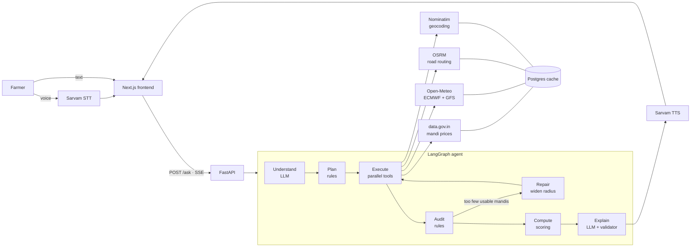
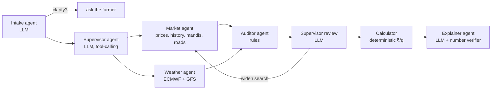

# Harvest Compass

**Which mandi, which day.** Harvest Compass helps an Indian farmer decide where to sell a harvest and when to cut it. You tell it your crop, how much you have and your village. It works out which mandi leaves the most money in your hand after transport, and which days look dry enough to harvest and move the crop.

You can ask by voice or text, in English or any of the 22 scheduled Indian languages. It covers 80 crops in every state that reports to the government's mandi price feed.

- **Live app:** https://harvest-compass.vercel.app
- **API:** https://harvest-compass-api-473741567970.asia-south1.run.app (`/health`, `/stats`)

> *"I have 40 quintals of soybean in Sanwer village, Indore. Where should I sell?"*
>
> Best mandi: Sanwer APMC, 2.4 km away. About ₹6,840 per quintal in hand after transport. Dry days to harvest: 1 and 6 November. Confidence: high.

## Why we built it

Most farmers sell at the nearest mandi, or wherever a trader points them. Prices differ from mandi to mandi, but so does the cost of getting there, so the highest listed price is often not the best deal. The public price data that could help is scattered, published in English, often a few days old, and sometimes skewed by one odd lot. Rain on harvest day or transport day spoils the crop, and forecasts rarely come in a form a farmer can act on.

## What it does

- **Finds the best mandi after transport.** It ranks every reachable mandi in your state by money in hand per quintal: the mandi's 7-day median price, minus the round trip at your own vehicle rate, minus any hammali or weighing charges you enter.
- **Picks safe harvest days.** It marks a day as safe only when two independent weather models (ECMWF and GFS) both expect no rain on that day and on the transport day after it.
- **Answers "should I wait?"** It shows each mandi's recent price trend, clearly labelled as a past trend and not a forecast, plus a "bad-day price" for that mandi.
- **Checks every price before using it.** Stale reports, one-off outliers, wide quality spreads and non-comparable varieties are set aside, and the reason is shown.
- **Shows its sources.** Every number links back to the public dataset it came from. The language model never does arithmetic, and any reply with a number the calculator didn't produce is rejected.
- **Asks when it isn't sure.** One short follow-up at a time: your vehicle rate, how many kg are in a bori, or which of several villages with the same name you mean. If you ask something outside its job, such as which crop to grow, it says so and explains what it can help with instead.

The result page also has a money breakdown that adds up exactly, editable vehicle numbers, a 14-day price line for each mandi, a map, a one-tap "use my saved vehicle" button, and a "Share on WhatsApp" button. On wide screens you can watch the agent's seven steps run live in a side panel.

## How it works

The farmer's question goes through a short, fixed pipeline. Language models are used only at the two ends: to read the question and to phrase the answer. Everything in between is plain code.

1. **Understand.** The language model turns the question into a typed request: crop, quantity, village, ready dates, vehicle. If something is missing, the agent asks one question.
2. **Plan.** Rules decide which data the question needs.
3. **Fetch.** Mandi prices, two weather models and road distances are fetched in parallel. Every response is cached with its source URL and fetch time.
4. **Check.** Rules set aside prices older than 3 days, prices with min above max, and robust outliers against the mandi's own history. Varieties and grades are kept like for like.
5. **Recover.** If a source fails, the agent falls back: each mandi's last stored report, the remaining weather model, or a wider search radius (150 km, then 200, then 250).
6. **Calculate.** Pure functions compute net price per quintal, the bad-day price, harvest-day safety and the trend. If a farther mandi wins by ₹50 a quintal or less, the nearer one is recommended.
7. **Answer.** The language model writes the reply in the farmer's language. A validator checks every number and mandi name against the computed facts, retries once, and falls back to a fixed template.



Each step streams trace events to the browser over Server-Sent Events, so the farmer sees the agent working instead of a spinner.

### Multi-agent mode (`AGENT_MODE=multi`)

The same tools can also run as a team of agents directed by a language-model supervisor (LangGraph supervisor pattern, `backend/app/agent/multi_graph.py`):



| Agent | Kind | Job |
|---|---|---|
| Intake | LLM | Free text → typed request; asks back when unsure |
| Supervisor | LLM, tool-calling | Picks which specialists run, then after the audit decides whether to widen the market search or hand over |
| Market | Tools | Today's prices, 30-day history, mandi locations, road distances |
| Weather | Tools | Rain forecast from two models, in parallel with Market |
| Auditor | Rules | Removes stale, odd or inconsistent prices |
| Calculator | Deterministic | Money in hand per quintal and harvest days; the LLM never computes money |
| Explainer | LLM + verifier | Answer in the farmer's language; rejects any number the calculator didn't produce |

The supervisor is kept on a short leash. It sees a board of counts only (no farmer text, no prices). Its only tools are `dispatch`, `widen_search` (up to 250 km, at most 2 extra rounds) and `proceed`. Each decision times out after 6 s, and any error or out-of-bounds move falls back to the pipeline's rules, with a note in the trace. `scripts/compare_modes.py` runs the same questions through both modes: on 1 Nov 2026 all 8 cases (including an injection attempt and two source failures) gave the same mandi and ₹/q, with 0 invented numbers. Switch per question with `"mode": "multi"` in `/ask`, or for the whole service with `AGENT_MODE`.

## Mandi fees

In seven states the market law puts the mandi fee on the buyer, so the farmer pays nothing, and the answer names the law (`backend/app/data/fees.py`). Each entry was checked against the Act's text or a Supreme Court judgment:

| State | Source |
|---|---|
| Madhya Pradesh | Krishi Upaj Mandi Adhiniyam 1972, Sec. 19(2) |
| Uttar Pradesh | Krishi Utpadan Mandi Adhiniyam 1964, Sec. 17(iii)(b); Supreme Court, *Krishi Utpadan Mandi Samiti v. Indian Wood Products*, AIR 1996 SC 1251 |
| Punjab | Agricultural Produce Markets Act 1961, Sec. 23; Supreme Court, *State of Punjab v. Guranditta Mal Shanti Prakash*, 5 May 2004 |
| Rajasthan | Agricultural Produce Markets Act 1961, Sec. 17 (collected from licensed traders) |
| Karnataka | Agricultural Produce Marketing (R&D) Act 1966, Sec. 65(2) |
| Andhra Pradesh, Telangana | (Agricultural Produce and Livestock) Markets Act 1966, Sec. 12(2) |

In other states the answer says the market fee isn't included. Bihar (APMC Act repealed in 2006) and Kerala (no APMC Act) are left out on purpose: without a state rule, private markets may charge the farmer. Hammali and weighing charges are set by each mandi committee, so the farmer enters them if they pay them.

## Does it work?

**Backtest** (`app/backtest/run_backtest.py`). We replayed 60 days (31 Aug – 30 Oct 2026) for 30 real villages in Madhya Pradesh using the real price history. Each day the strategy picks a mandi using only what was known that day, and is scored on the next day's price against simply going to the nearest mandi. Mean gain in ₹ per quintal at assumed transport rates of ₹0.5 / 1 / 2 per quintal-km:

| Crop | Today's price | 7-day median | 7-day median + nearer on close calls (live) |
|---|---|---|---|
| Onion | +437 / +401 / +379 | +540 / +482 / +429 | +511 / +470 / +413 |
| Soybean | +27 / −32 / −73 | +61 / +15 / −4 | +69 / +39 / −5 |

Choosing the mandi matters a lot for onion, whose prices vary widely between mandis. Soybean prices are nearly uniform across the state, so the nearest mandi is usually close to the best. We picked these two crops because they are opposite cases. The live agent covers all 80 crops, and the backtest runs on any of them with `--crop`. About 30% of decisions could not be scored because the chosen mandi didn't report the next day.

**Grounding** (`scripts/grounding.py`). Twenty varied Hindi and Hinglish questions go through the full agent. Latest run (1 Nov 2026, evening): 18 answered and 0 invented numbers. One question correctly asked "is your village Mahidpur Tahsil?" and one failed once but answered on both reruns.

**Live usage** (`/stats`, last 7 days as of 1 Nov 2026): 99 questions, median answer time 10.8 s (95th percentile 33 s), 0 errors, 0 invented numbers. 12% of answers used the fixed template instead of the language model's wording.

## Data sources

| Source | Used for | Licence |
|---|---|---|
| [data.gov.in](https://data.gov.in) (Agmarknet): daily prices `9ef84268-…`, variety-wise history `35985678-…` | Mandi prices | Government Open Data License – India |
| [Open-Meteo](https://open-meteo.com): ECMWF IFS 0.25°, GFS | Rain forecast | CC BY 4.0 |
| [OSRM](https://project-osrm.org) | Road distance and drive time | ODbL (OpenStreetMap data) |
| [Nominatim](https://nominatim.org) | Village and mandi coordinates | ODbL; at most 1 request/s, results cached |
| [OpenStreetMap](https://www.openstreetmap.org/copyright) tiles | Map | ODbL |
| [Sarvam AI](https://www.sarvam.ai) | Speech input and output | API terms |
| [OpenRouter](https://openrouter.ai) | LLM access | API terms |

There is no made-up data anywhere. Every price, forecast and distance comes from these APIs or from a cached copy of their response, stored with `source_url` and `fetched_at`.

## Tech stack

| Layer | Technology |
|---|---|
| Frontend | Next.js 15, React 19, TypeScript, Tailwind CSS 4, Leaflet |
| Backend | Python 3.11, FastAPI, LangGraph, Pydantic v2, httpx |
| Database | PostgreSQL (Neon), psycopg 3: response cache and backtest results |
| LLM | `deepseek/deepseek-v4.1-flash` via OpenRouter |
| Speech | Sarvam AI: `saaras:v4` speech-to-text (23 languages), `bulbul:v4-flash` text-to-speech (9 languages) |
| Hosting | Google Cloud Run, Mumbai (backend, Docker); Vercel (frontend) |

## Project structure

```
backend/
  app/
    agent/        LangGraph graphs (pipeline: graph.py; multi-agent: multi_graph.py + supervisor.py), state and nodes
    tools/        one module per external source: mandi, weather, routing, geocode, voice
    scoring/      net price, harvest window, trend, audit rules (pure functions)
    backtest/     historical replay of the ranking strategy
    data/         cache, regions, crops and synonyms, state mandi-fee rules, request log
    main.py       FastAPI app: /ask (SSE), /transcribe, /health, /stats, /backtest
  scripts/        CLI tools: ask, smoke test, grounding test, compare modes, cache warm-up, UI translation
  tests/          pytest suite
frontend/
  app/            pages: home, ask, how it works, results, data, about
  components/     shared UI (map, flow diagram, backtest and usage cards)
  lib/            API client, i18n
  locales/        UI text for 23 languages (English and Hindi written by hand, the rest machine-translated and checked)
```

## Run it locally

You need Python 3.11+, [uv](https://docs.astral.sh/uv/) and Node.js 20+.

```bash
cp .env.example .env          # then fill in your keys (see below)

# Backend
cd backend
uv sync
uv run uvicorn app.main:app --reload    # on Windows add: --loop asyncio:SelectorEventLoop

# Frontend, in a second terminal
cd frontend
npm install
npm run dev                             # http://localhost:3000
```

### Environment variables

| Variable | What it's for |
|---|---|
| `DATA_GOV_IN_API_KEY` | data.gov.in API key |
| `SARVAM_API_KEY` | Sarvam AI API key |
| `OPENROUTER_API_KEY` | OpenRouter API key |
| `LLM_MODEL` | Model ID, e.g. `deepseek/deepseek-v4.1-flash` |
| `DATABASE_URL` | PostgreSQL connection string |
| `NOMINATIM_USER_AGENT` | Identifying User-Agent for OpenStreetMap services |
| `FRONTEND_ORIGIN` | Allowed CORS origin |
| `VOICE_DAILY_LIMIT` | Daily cap on live Sarvam calls (default 60) |
| `AGENT_MODE` | `pipeline` (default) or `multi` |
| `NEXT_PUBLIC_API_URL` | Backend URL used by the frontend |

### Tests and tools

```bash
bash check.sh                                   # ruff, mypy --strict, pytest, eslint, tsc

cd backend
uv run python -m scripts.smoke                  # one live call to every data source
uv run python -m scripts.ask "25 quintal wheat, village Sanwer, Indore, vehicle ₹35/km, 30 q per trip"
uv run python -m scripts.ask "..." --fault weather_ecmwf    # simulate a source failure
uv run python -m scripts.grounding              # invented-number check over 20 questions
uv run python -m scripts.compare_modes          # pipeline vs multi-agent on the same questions
uv run python -m app.backtest.run_backtest      # results stored in the backtest_runs table
uv run python -m scripts.warm                   # pre-cache prices and mandi locations for all states
uv run python -m scripts.translate_ui           # fill missing UI strings in the 21 generated languages
```

## Deployment

- **Backend:** Google Cloud Run, `asia-south1` (Mumbai), built from `backend/Dockerfile`:
  ```bash
  cd backend
  gcloud run deploy harvest-compass-api --source . --region asia-south1 \
    --allow-unauthenticated --env-vars-file env.yaml \
    --memory 512Mi --min-instances 0 --max-instances 2 --timeout 300
  ```
  `env.yaml` holds the environment variables above and is never committed. Leave out `--env-vars-file` to keep the variables already set on the service. `--source .` uploads the folder as it is on disk, so deploy from a clean checkout. `render.yaml` is kept as an alternative Render blueprint.
- **Frontend:** Vercel, project root `frontend`, with `NEXT_PUBLIC_API_URL` pointing to the backend. Every push to `master` redeploys it.
- **Price data from the cloud:** data.gov.in refuses requests from cloud data-centre IPs (403 from Cloud Run). The hosted backend therefore answers from the shared cache, which `uv run python -m scripts.warm --all-crops` refreshes every day at 4 am from a machine in India (Windows task `HarvestCompassWarm`). It pulls today's prices plus 14 days of history for every crop in every state, one request per state and day, and 30 days for soybean and onion. A day that comes back empty is retried on the next run rather than stored, because data.gov.in sometimes answers a busy day with zero records and no error.
- `/health` runs light checks against each source (cached for 60 s) and accepts `HEAD` for uptime monitors. Error messages mask API keys, and request URLs carrying keys are kept out of the logs.
- Rate limits: 10 paid requests per minute per client, 300 per hour overall.

## Limitations

- It is a selling-decision tool. It doesn't advise on what to grow, seeds, fertiliser or pests.
- Transport cost depends on the vehicle rate the farmer gives. The backtest uses assumed rates.
- Only mandis inside the farmer's state are compared.
- Price history lags a day, and many mandis don't report every day. Uttar Pradesh has barely reported since 22 Oct 2026, so answers there are thin.
- Weather forecasts cover 7 days. Later dates are shown without a forecast.
- The mandi-fee rule is checked for 7 states only.
- Storage costs are not part of the "should I wait?" answer.
- Rate limiting is in memory and assumes a single backend instance.
- The first question from a state with no cached mandi locations is slow, because Nominatim allows one lookup per second. `scripts.warm` fills these in advance.

## What's next

These come from questions we couldn't answer yet and gaps we found while testing.

1. **Best month to sell.** Show which months usually pay best for a crop at the farmer's nearby mandis, from data.gov.in history going back to 2010. This answers *"if I plant now and harvest in three months, will prices be good then?"* using past patterns only, never a forecast.
2. **Sowing calendar.** Sowing and harvest windows per crop and state, typed in from official ICAR and state agriculture department calendars, with the source cited the same way the mandi-fee rules are.
3. **MSP comparison.** Show how far the mandi price is above or below this year's minimum support price, and point to a government procurement centre when the mandi pays less.
4. **Price alerts.** *"Tell me when Indore pays ₹7,200."* Free options exist: browser push notifications or a Telegram bot, run after the daily cache refresh.
5. **Mandi fees for more states.** Maharashtra, Haryana, Gujarat and Tamil Nadu first, each checked against the Act's text.
6. **Sell now or store?** Add a storage cost per quintal per week, so "should I wait?" accounts for what waiting costs.
7. **Cross-state mandis.** A farmer near a state border may get a better price across it.
8. **Works offline.** An installable app (PWA) that keeps the last answer for patchy rural networks.
9. **Phone line for feature phones.** A missed-call or IVR line reusing the speech pieces already built.

## Team: MCTE CODE CLUB

- Manoj Kumar
- Rishabh Yadav
- Saiyam Jain
