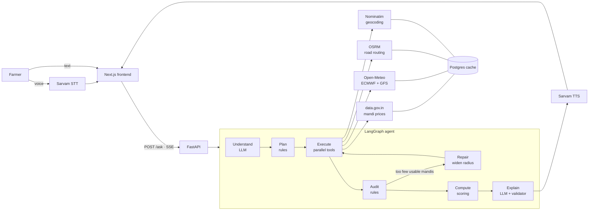
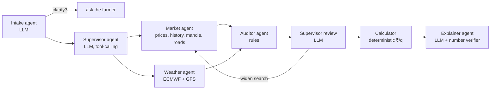

# Harvest Compass

An AI agent that tells Indian farmers which mandi pays the most after transport costs, and which days are dry enough to harvest and move the crop. Farmers ask by voice or text in English or any of the 22 scheduled Indian languages.

## Problem

Most farmers sell at the nearest mandi or wherever a trader suggests. Prices vary between mandis, but so does the cost of reaching them, so the highest listed price is often not the best deal. The public price data that could help is scattered, published in English, often several days old, and sometimes distorted by a single unusual lot. Rain on harvest or transport day damages the crop, and forecasts are rarely presented in a form a farmer can act on.

## Solution

The farmer describes their crop, quantity and village. The agent:

1. Extracts a structured request from the question and asks one short follow-up when something is missing or ambiguous (vehicle hire rate, sack weight, which of two villages with the same name).
2. Fetches current and historical mandi prices, two weather models and road distances in parallel.
3. Audits the prices and excludes stale, inconsistent, outlier and non-comparable entries, recording the reason for each.
4. Ranks every reachable mandi in the farmer's state by **net ₹ per quintal**: the 7-day median price minus round-trip transport at the farmer's own vehicle rate.
5. Marks harvest days as safe only when both weather models expect no rain, including the transport day that follows.
6. Replies in the farmer's language, as text and, where a voice is available, as speech.

The language model is used only to read the question and to phrase the reply. Every number is computed by deterministic code, and a validator rejects any reply that contains a number or mandi name not present in the computed facts.

## Architecture



Each node streams trace events to the frontend over Server-Sent Events, so the user sees every step as it runs.

| Step | Implementation | Responsibility |
|---|---|---|
| Understand | LLM (forced tool call) | Convert free text into a typed intent: crop, quantity, village, harvest window, vehicle rate. Ask a clarifying question when required. |
| Plan | Rules | Choose which data sources the question needs. |
| Execute | Async tools | Call all sources concurrently with timeouts and one retry. Cache each response with its source URL and fetch time. |
| Audit | Rules | Reject prices older than 3 days, with min > max, or that are robust z-score outliers against the mandi's own 30-day history and the region; keep variety and grade comparable. |
| Repair | Rules | Fall back to each mandi's latest stored report if today's feed fails, to the remaining weather model if one fails, or widen the search radius from 150 km to 250 km. |
| Compute | Pure functions | Net price per quintal, conservative "bad-day" price, harvest-day safety, and the 14-day price trend for "should I wait?" questions. If a farther mandi wins by ₹50/quintal or less, the nearer one is recommended. |
| Explain | LLM + validator | Phrase the result in the farmer's language. Replies with unknown numbers or altered mandi names are rejected, retried once, then replaced by a fixed template. |

### Multi-agent mode (`AGENT_MODE=multi`)

The same tools, run as a team of agents directed by an LLM supervisor (LangGraph supervisor pattern, `backend/app/agent/multi_graph.py`):



| Agent | Kind | Job |
|---|---|---|
| Intake | LLM | Free text → typed intent; asks back when unsure |
| Supervisor | LLM, tool-calling | Picks which specialists run (dispatch), then after the audit decides to widen the market search or hand over |
| Market | Tools | Today's prices, 30-day history, locate mandis, road distances |
| Weather | Tools | Rain forecast from two models; runs in parallel with Market |
| Auditor | Rules | Stale, odd or inconsistent prices out |
| Calculator | Deterministic | Money in hand per quintal, harvest days; the LLM never computes money |
| Explainer | LLM + verifier | Answer in the farmer's language; rejects any number the calculator didn't produce |

Guardrails on the supervisor: it sees a board of counts only (no farmer text, no prices), its tools allow only `dispatch`, `widen_search` (≤ 250 km, ≤ 2 extra rounds) and `proceed`, each decision times out after 6 s, and any error or out-of-bounds move falls back to the pipeline's rules and says so in the trace. Every trace line carries the agent that produced it. `scripts/compare_modes.py` runs the same questions through both modes; on 1 Nov 2026 all 8 cases (incl. an injection attempt and two source failures) gave the same mandi and ₹/q, with 0 invented numbers. Switch per question with `"mode": "multi"` in `/ask`, or for the whole service with `AGENT_MODE`.

## Tech stack

| Layer | Technology |
|---|---|
| Frontend | Next.js 15, React 19, TypeScript, Tailwind CSS 4, Leaflet |
| Backend | Python 3.11, FastAPI, LangGraph, Pydantic v2, httpx |
| Database | PostgreSQL (Neon), psycopg 3: response cache and backtest results |
| LLM | `deepseek/deepseek-v4.1-flash` via OpenRouter |
| Speech | Sarvam AI: `saaras:v4` speech-to-text (23 languages), `bulbul:v4-flash` text-to-speech (9 languages) |
| Hosting | Google Cloud Run, Mumbai (backend, Docker), Vercel (frontend) |

## Project structure

```
backend/
  app/
    agent/        LangGraph graphs (pipeline: graph.py; multi-agent: multi_graph.py + supervisor.py), state and nodes
    tools/        one module per external source: mandi, weather, routing, geocode, voice
    scoring/      net profit, harvest window, trend, audit rules (pure functions)
    backtest/     historical replay of the ranking strategy
    data/         cache, regions, crop synonyms, request log
    main.py       FastAPI app: /ask (SSE), /transcribe, /health, /stats, /backtest
  scripts/        CLI tools: ask, smoke test, grounding test, cache warm-up, UI translation
  tests/          pytest suite
frontend/
  app/            pages: home, ask, how-it-works, results, data, about
  components/     shared UI (map, flow diagram, backtest and usage cards)
  lib/            API client, i18n
  locales/        UI text for 23 languages (English and Hindi hand-written, others generated)
```

## Data sources

| Source | Used for | Licence |
|---|---|---|
| [data.gov.in](https://data.gov.in) (Agmarknet): daily prices `9ef84268-…`, variety-wise history `35985678-…` | Mandi prices | Government Open Data License – India |
| [Open-Meteo](https://open-meteo.com): ECMWF IFS 0.25°, GFS | Rain forecast | CC BY 4.0 |
| [OSRM](https://project-osrm.org) | Road distance and drive time | ODbL (OpenStreetMap data) |
| [Nominatim](https://nominatim.org) | Village and mandi coordinates | ODbL; ≤ 1 request/s, results cached |
| [OpenStreetMap](https://www.openstreetmap.org/copyright) tiles | Map | ODbL |
| [Sarvam AI](https://www.sarvam.ai) | Speech input and output | API terms |
| [OpenRouter](https://openrouter.ai) | LLM access | API terms |

All prices, forecasts and distances come from these APIs or from cached copies of their responses, stored with `source_url` and `fetched_at`.

**Mandi fee.** In seven states the market law puts the market fee on the buyer, so the seller's fee is zero, and the answer cites the source (`backend/app/data/fees.py`):

| State | Source |
|---|---|
| Madhya Pradesh | Krishi Upaj Mandi Adhiniyam 1972, Sec. 19(2) |
| Uttar Pradesh | Krishi Utpadan Mandi Adhiniyam 1964, Sec. 17(iii)(b); Supreme Court, *Krishi Utpadan Mandi Samiti v. Indian Wood Products*, AIR 1996 SC 1251 |
| Punjab | Agricultural Produce Markets Act 1961, Sec. 23; Supreme Court, *State of Punjab v. Guranditta Mal Shanti Prakash*, 5 May 2004 |
| Rajasthan | Agricultural Produce Markets Act 1961, Sec. 17 (collected from licensed traders) |
| Karnataka | Agricultural Produce Marketing (R&D) Act 1966, Sec. 65(2) |
| Andhra Pradesh, Telangana | (Agricultural Produce and Livestock) Markets Act 1966, Sec. 12(2) |

Other states are not encoded yet, and there the answer says the market fee is not included. Bihar (APMC Act repealed in 2006) and Kerala (no APMC Act) are left out on purpose: with no state rule, private markets may charge the farmer. Hammali and weighing charges vary by mandi committee and are entered by the user.

## Evaluation

**Backtest** (`app/backtest/run_backtest.py`): run on two test crops, onion (prices vary a lot between mandis) and soybean (prices nearly uniform). The live agent covers all 80 crops in `app/data/crops.py`, and the backtest takes any of them with `--crop`. 30 villages in Madhya Pradesh, 60 days (31 Aug – 30 Oct 2026), real data.gov.in history. Each day the strategy chooses a mandi using only data available that day, and is scored on the next day's price against the nearest mandi. Mean gain in ₹/quintal at assumed transport rates of ₹0.5 / 1 / 2 per quintal-km:

| Crop | Today's price | 7-day median | 7-day median + nearer on close calls (live) |
|---|---|---|---|
| Onion | +437 / +401 / +379 | +540 / +482 / +429 | +511 / +470 / +413 |
| Soybean | +27 / −32 / −73 | +61 / +15 / −4 | +69 / +39 / −5 |

Choosing the mandi matters for onion, where prices vary widely between mandis. Soybean prices are nearly uniform across the state, so the nearest mandi is usually close to optimal. About 30% of decisions could not be scored because the chosen mandi did not report the next day.

**Grounding** (`scripts/grounding.py`): 20 varied Hindi and Hinglish questions run through the full agent. 19 answered, 1 correctly asked for clarification; 0 invented numbers; median latency 11.4 s, p95 15.3 s.

## Getting started

Requirements: Python 3.11+, [uv](https://docs.astral.sh/uv/), Node.js 20+.

```bash
cp .env.example .env

# Backend
cd backend
uv sync
uv run uvicorn app.main:app --reload    # on Windows add: --loop asyncio:SelectorEventLoop

# Frontend (new terminal)
cd frontend
npm install
npm run dev                             # http://localhost:3000
```

### Environment variables

| Variable | Description |
|---|---|
| `DATA_GOV_IN_API_KEY` | data.gov.in API key |
| `SARVAM_API_KEY` | Sarvam AI API key |
| `OPENROUTER_API_KEY` | OpenRouter API key |
| `LLM_MODEL` | Model ID, e.g. `deepseek/deepseek-v4.1-flash` |
| `DATABASE_URL` | PostgreSQL connection string |
| `NOMINATIM_USER_AGENT` | Identifying User-Agent for OpenStreetMap services |
| `FRONTEND_ORIGIN` | Allowed CORS origin |
| `VOICE_DAILY_LIMIT` | Daily cap on live Sarvam calls (default 60) |
| `NEXT_PUBLIC_API_URL` | Backend URL used by the frontend |

## Testing

```bash
bash check.sh                                   # ruff, mypy --strict, pytest, eslint, tsc

cd backend
uv run python -m scripts.smoke                  # one live call to every data source
uv run python -m scripts.ask "25 quintal wheat, village Sanwer, Indore, vehicle ₹35/km, 30 q per trip"   # any crop in app/data/crops.py
uv run python -m scripts.ask "..." --fault weather_ecmwf    # simulate a source failure
uv run python -m scripts.grounding              # invented-number check over 20 questions
uv run python -m app.backtest.run_backtest      # results stored in the backtest_runs table
uv run python -m scripts.warm                   # pre-cache prices and mandi locations for all states
```

## Deployment

- **Backend:** Google Cloud Run, region `asia-south1` (Mumbai), built from `backend/Dockerfile`:
  ```bash
  cd backend
  gcloud run deploy harvest-compass-api --source . --region asia-south1 \
    --allow-unauthenticated --env-vars-file env.yaml \
    --memory 512Mi --min-instances 0 --max-instances 2 --timeout 300
  ```
  `env.yaml` holds the environment variables above (not committed). `render.yaml` is kept as an alternative Render blueprint.
- **Frontend:** Vercel, root `frontend`, with `NEXT_PUBLIC_API_URL` pointing to the backend.
- **data.gov.in from cloud hosts:** the API refuses requests from cloud data-centre IPs (403 from Cloud Run, connection refused from Render). The backend then serves the latest cached prices with their date. `uv run python -m scripts.warm --all-crops` runs daily at 4 am from a machine in India (Windows task `HarvestCompassWarm`): today's prices plus 14 days of history for every crop in every state (one data.gov.in request per state and day), 30 days for soybean and onion.
- `/health` runs lightweight checks against each source (cached for 60 s); error messages mask API keys.
- Rate limits: 10 paid requests per minute per client, 300 per hour overall.

## Limitations

- Transport cost depends on the rate the farmer provides; the backtest uses assumed rates.
- data.gov.in history lags by a day and many mandis do not report daily.
- Only mandis within the farmer's state are compared.
- Weather forecasts cover 7 days; later dates are shown without a forecast.
- The market-fee rule is encoded for 7 states (MP, UP, Punjab, Rajasthan, Karnataka, Andhra Pradesh, Telangana). In other states the fee isn't included and the answer says so.
- Rate limiting is in-memory and assumes a single backend instance.
- The first query from a state with no cached mandi locations is slow, because Nominatim allows one lookup per second; `scripts.warm` pre-fills the cache.

## Team: MCTE CODE CLUB

- Manoj Kumar
- Rishabh Yadav
- Saiyam Jain
